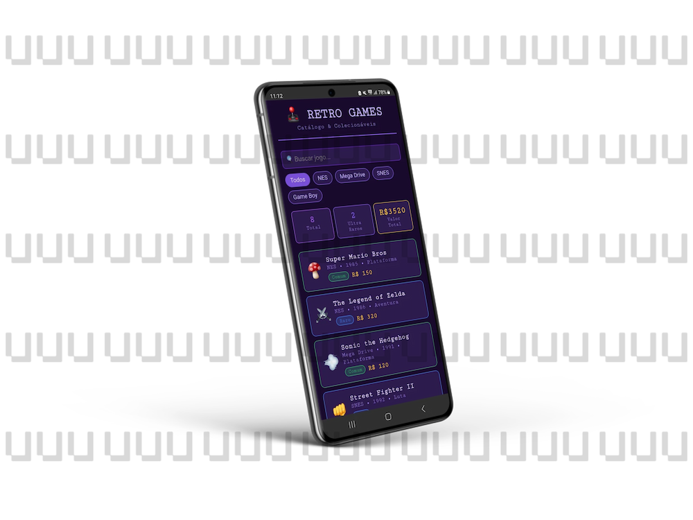
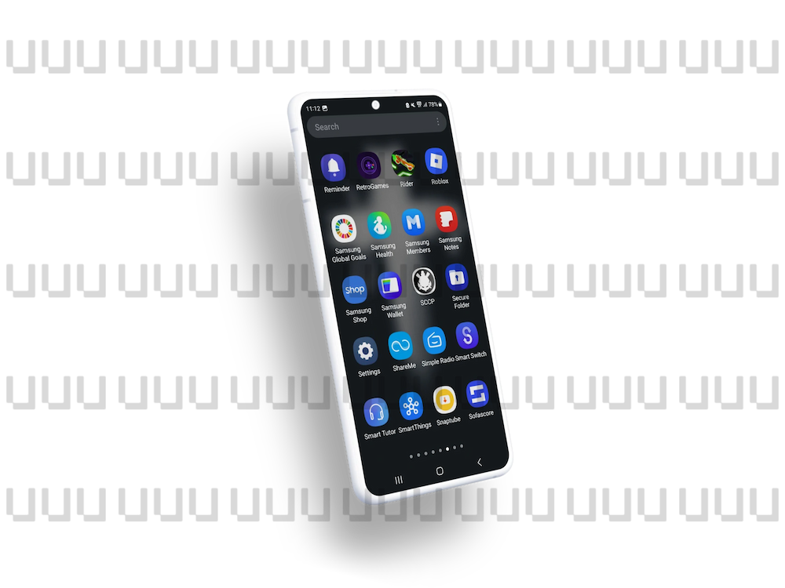

# 🕹️ RetroGames — Catálogo & Colecionáveis

Aplicativo mobile (Android) de catálogo de jogos retrô, feito com **React + TypeScript + Vite** e empacotado como app nativo com **Capacitor**. O projeto foi desenvolvido como atividade da **Aula 16**.

## 📱 Screenshots

| Tela principal (catálogo) | Ícone no celular |
| :---: | :---: |
|  |  |

## ℹ️ Detalhes do app

| Item | Valor |
| --- | --- |
| Nome | RetroGames |
| ID do pacote (`appId`) | `com.retrogames.catalogo` |
| Plataforma | Android (via Capacitor) |
| Tema visual | Roxo escuro estilo retrô (`#1a0a2e`), fonte monoespaçada *Courier New* |
| Splash screen | 3 segundos, fundo `#1a0a2e`, sem spinner |
| Idioma | Português (Brasil) |

## ✨ Funcionalidades

- **Catálogo de jogos retrô** com 8 títulos clássicos (NES, SNES, Mega Drive e Game Boy).
- **Busca por nome**: filtra a lista enquanto você digita.
- **Filtro por console**: botões para *Todos*, *NES*, *Mega Drive*, *SNES* e *Game Boy* (gerados automaticamente a partir dos jogos).
- **Painel de estatísticas** que acompanha os filtros aplicados:
  - **Total** de jogos exibidos;
  - **Ultra Raros** na lista;
  - **Valor Total** em reais.
- **Cartões de jogo** com emoji, título, console, ano, gênero, preço e selo de raridade.
- **Raridade por cor**: 🟢 Comum, 🔵 Raro, 🟣 Ultra Raro.
- **Estado vazio**: mostra "Nenhum jogo encontrado" quando a busca não retorna resultados.

### Jogos do catálogo

| Jogo | Console | Ano | Gênero | Raridade | Preço |
| --- | --- | :---: | --- | --- | ---: |
| Super Mario Bros | NES | 1985 | Plataforma | Comum | R$ 150 |
| The Legend of Zelda | NES | 1986 | Aventura | Raro | R$ 320 |
| Sonic the Hedgehog | Mega Drive | 1991 | Plataforma | Comum | R$ 120 |
| Street Fighter II | SNES | 1992 | Luta | Raro | R$ 280 |
| Chrono Trigger | SNES | 1995 | RPG | Ultra Raro | R$ 850 |
| Earthbound | SNES | 1994 | RPG | Ultra Raro | R$ 1.200 |
| Pokémon Red | Game Boy | 1996 | RPG | Comum | R$ 180 |
| Castlevania | NES | 1986 | Ação | Raro | R$ 420 |

## 🧰 Tecnologias

- [React 19](https://react.dev/)
- [TypeScript](https://www.typescriptlang.org/)
- [Vite 8](https://vite.dev/)
- [Capacitor 8](https://capacitorjs.com/) (`@capacitor/android`, `@capacitor/splash-screen`)
- [@capacitor/assets](https://github.com/ionic-team/capacitor-assets) para gerar ícone e splash
- GitHub Actions para gerar a APK automaticamente

## 📂 Estrutura do projeto

```
aula-16/
├── .github/workflows/android-build.yml   # CI: build da APK debug
├── android/                              # Projeto Android nativo (Capacitor)
├── assets/                               # icon.png e splash.png (fontes dos assets nativos)
├── docs/screenshots/                     # Imagens usadas neste README
├── public/                               # Arquivos estáticos (favicon, ícones SVG)
├── src/
│   ├── App.tsx                           # Tela e lógica do catálogo
│   ├── App.css                           # Estilos globais
│   └── main.tsx                          # Ponto de entrada do React
├── capacitor.config.json                 # Configuração do Capacitor
├── index.html
├── package.json
├── tsconfig.json
└── vite.config.ts
```

## 🚀 Como rodar

### Pré-requisitos

- **Node.js 22** ou superior (exigido pelo Capacitor 8)
- **Java 21** e Android Studio (apenas para gerar o app Android localmente)

### Versão web (desenvolvimento)

```bash
git clone https://github.com/FelipeGoesSccp/aula-16.git
cd aula-16
npm install
npm run dev
```

Abra o endereço mostrado no terminal (normalmente `http://localhost:5173`).

### Build de produção

```bash
npm run build
```

Os arquivos finais são gerados na pasta `dist/`.

### Rodar no Android

```bash
npm run build
npx capacitor-assets generate --android   # gera ícone e splash
npx cap sync android                      # copia o build web para o projeto Android
npx cap open android                      # abre no Android Studio
```

No Android Studio, escolha um emulador ou celular conectado e clique em **Run**.

Para gerar a APK pela linha de comando:

```bash
cd android
./gradlew assembleDebug
```

A APK sai em `android/app/build/outputs/apk/debug/app-debug.apk`.

## 🤖 CI/CD — APK automática

O workflow [`android-build.yml`](.github/workflows/android-build.yml) roda a cada push nas branches `main` ou `master` e:

1. instala as dependências (`npm ci`);
2. faz o build do projeto React (`npm run build`);
3. gera os assets nativos do Android;
4. sincroniza com o projeto Android (`npx cap sync android`);
5. compila a APK debug com Gradle;
6. publica a APK como artefato `meu-aplicativo-apk` (disponível por 7 dias).

Para baixar: aba **Actions** do repositório → execução mais recente → seção **Artifacts**.

## 📜 Scripts disponíveis

| Comando | O que faz |
| --- | --- |
| `npm run dev` | Inicia o servidor de desenvolvimento |
| `npm run build` | Verifica os tipos (`tsc`) e gera o build de produção |
| `npm run preview` | Serve localmente o build de produção |

## 👤 Autor

Felipe — [@FelipeGoesSccp](https://github.com/FelipeGoesSccp)
